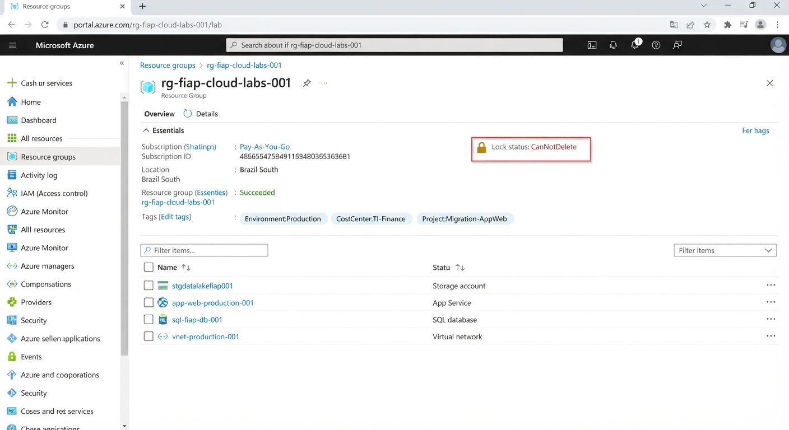

# ☁️ Infraestrutura Global e Governança no Microsoft Azure

Repositório desenvolvido como parte do Desafio de Projeto da **DIO (Digital Innovation One)**, com o objetivo de documentar a arquitetura global do Azure, boas práticas de governança, controle de acesso, compliance e provisionamento básico de recursos.

---

## 📋 Índice
- [Infraestrutura Global e Regiões](#1-infraestrutura-global-e-regiões)
- [Replicação, Compliance e LGPD](#2-replicação-compliance-e-lgpd)
- [Governança e Organização de Recursos](#3-governança-e-organização-de-recursos)
- [Segurança e Monitoramento (IAM e Logs)](#4-segurança-e-monitoramento-iam-e-logs)
- [Redes Virtuais (VNet) e Implantações](#5-redes-virtuais-vnet-e-implantações)
- [Referências Úteis](#6-referências-úteis)

---

## 1. Infraestrutura Global e Regiões

A infraestrutura global do Microsoft Azure é composta por uma rede extensa de datacenters distribuídos estrategicamente pelo mundo para garantir baixa latência, alta disponibilidade e resiliência.

* **Regiões (Regions):** Conjuntos de datacenters implantados dentro de um perímetro definido por latência e conectados por uma rede dedicada de alta velocidade.
* **Zonas de Disponibilidade (Availability Zones):** Locais físicos exclusivos dentro de uma região do Azure, cada um equipado com energia, refrigeração e rede independentes para proteger aplicações contra falhas de datacenter.
* **Mapa Interativo:** É possível explorar a distribuição física, cabos submarinos e geografias através do [Mapa Global de Datacenters da Microsoft](https://datacenters.microsoft.com/globe/explore?info=geography_brazil).

---

## 2. Replicação, Compliance e LGPD

A escolha da região e da estratégia de replicação impacta diretamente a continuidade de negócios e a conformidade legal:

* **Pares de Regiões (Region Pairs):** Cada região do Azure geralmente possui um par dentro da mesma geografia para replicação de dados e recuperação de desastres (ex.: *Brazil South* e *South Central US*).
* **LGPD e Soberania de Dados:** Para empresas que operam no Brasil e lidam com dados sensíveis sujeitos à **Lei Geral de Proteção de Dados (LGPD)**, é fundamental atenção às políticas de residência de dados. Caso a replicação envie dados para fora do território nacional, a organização deve validar os termos contratuais e de conformidade (*Data Processing Addendum - DPA*) junto à Microsoft, garantindo que o tratamento atenda às exigências legais.

---

## 3. Governança e Organização de Recursos

Durante o laboratório prático no Portal do Azure, foram aplicados conceitos fundamentais de gerenciamento e controle de custos:

### Criação de Grupo de Recursos (Resource Group)
Contêiner lógico que agrupa recursos relacionados de uma solução no Azure, facilitando o gerenciamento do ciclo de vida (implantação, atualização e exclusão conjunta).

> 
> 📸  *Fonte: [Documentação Oficial do Microsoft Azure](https://learn.microsoft.com/pt-br/azure/)*

### Marcações (Tags) e Gestão de Custos
As **Tags** são pares de `chave:valor` atribuídos aos recursos ou grupos de recursos (ex.: `Ambiente: Producao`, `CentroDeCusto: TI`).
* **Benefício financeiro:** Permitem filtrar e detalhar o extrato de faturamento (*Cost Management*), facilitando o rateio de gastos por projeto, departamento ou ambiente.

### Bloqueios de Segurança (Resource Locks)
Mecanismo de proteção para evitar alterações ou exclusões acidentais de recursos críticos, mesmo por usuários com permissões administrativas:
* **CanNotDelete (Não pode excluir):** Usuários autorizados podem ler e modificar o recurso, mas não podem excluí-lo.
* **ReadOnly (Somente leitura):** Usuários autorizados podem apenas ler o recurso, sem permissão para modificar ou excluir.

---

## 4. Segurança e Monitoramento (IAM e Logs)

* **IAM (Identity and Access Management):** Controle de acesso baseado em função (**RBAC**). Permite conceder permissões granulares seguindo o princípio do privilégio mínimo (ex.: *Proprietário*, *Colaborador*, *Leitor*) em escopos específicos (Assinatura, Grupo de Recursos ou Recurso individual).
* **Log de Atividades (Activity Log):** Registro de auditoria da plataforma que rastreia operações no plano de controle — respondendo *"quem fez o quê, quando e em qual recurso"* (criação, modificação ou exclusão de serviços).

---

## 5. Redes Virtuais (VNet) e Implantações

* **Rede Virtual (Azure VNet):** Bloco de construção fundamental para redes privadas no Azure. Permite que recursos (como VMs e bancos de dados) se comuniquem com segurança entre si, com a internet e com redes locais (*on-premises*), utilizando segmentação por sub-redes (*Subnets*) e regras de filtragem de tráfego.
* **Implantações (Deployments):** Histórico e gerenciamento das execuções de provisionamento dentro de um Grupo de Recursos (via Portal, CLI, PowerShell ou templates ARM/Bicep), permitindo auditar o status, parâmetros utilizados e possíveis falhas na criação da infraestrutura.

---

## 6. Referências Úteis

* [Documentação Oficial do Microsoft Azure](https://learn.microsoft.com/pt-br/azure/)
* [Explorar Infraestrutura Global do Azure](https://datacenters.microsoft.com/globe/explore?info=geography_brazil)
* [Visão Geral do Azure Resource Manager (ARM)](https://learn.microsoft.com/pt-br/azure/azure-resource-manager/management/overview)
